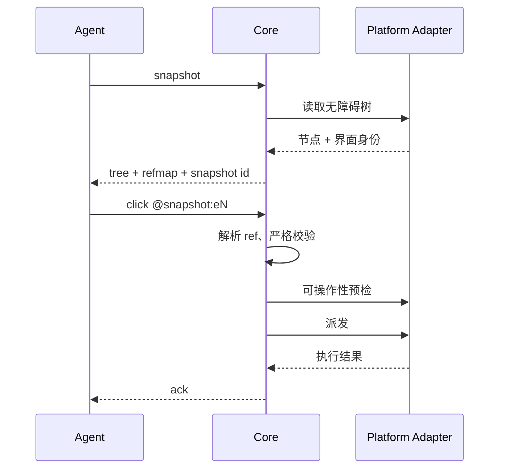

# 第 1 章 观察、引用与失效

## 本章要回答什么

第 1 章只回答三个问题：

1. 一次观察从命令到快照，经过哪些层？
2. 快照里的引用怎么分配、限定，又怎么会失效？
3. 观察没看全时，结果怎么表示、怎么保存、怎么被拒绝？

行动、预检和派发放到第 2 章；本章只把"观察这一侧"讲透。

## 一次调用的完整链路

链路里有两次"观察"：第一次产出快照和引用，第二次确认动作结果。中间那次行动不改引用表，只消费它。

## 五节的分工

| 小节 | 回答的问题 | 主要对象 |
| --- | --- | --- |
| 1.1 模块地图 | 代码分成哪几层，谁依赖谁 | `lib.rs` 的模块声明 |
| 1.2 观察 | 命令怎么分叉，快照由什么组成 | `SnapshotArgs`、`SnapshotResult`、`build_for_owners` |
| 1.3 引用 | ref 如何分配、限定 | `RefMap`、`ref_token`、`remove_by_root_ref` |
| 1.4 完整性 | 没看全怎么表示、怎么保存 | `complete`、`identity_unproven`、`save_refmap`、`RefStore` |
| 1.5 下钻与失效 | 下钻为什么必须完整，过期引用怎么被拒绝 | `drill_capture`、`drill_incomplete`、`resolve_saved_ref` |

五节按"观察 → 引用 → 完整性 → 失效"排，不是按文件顺序排；一个知识点会跨多个文件，字幕会说明每次跳转。

## 阅读约定

- **只读**：本章只打开和定位文件，不修改源码。任何编辑都会让行号漂移。
- **按行讲**：每条字幕对应屏幕上几行代码，先定位再讲解。
- **先跳过平台分支**：`crates/macos`、`crates/windows`、`crates/linux` 只在需要解释"为什么这里不通用"时再看。
- **失败也是设计**：看到 `stale_ref`、`drill_incomplete`、`INVALID_ARGS` 时，先问"它在保护什么"，而不是"怎么绕过"。

## 关键对象速览

| 对象 | 一句话 |
| --- | --- |
| `SnapshotResult` | 一次观察的完整产出：树、引用表、owner、完整性 |
| `RefMap` | ref 到身份证据的映射，不存坐标 |
| `RefEntry` | 单个元素的身份证据：进程、角色、稳定字段 |
| `preflight` | 动作前的可操作性检查，可能触发滚动恢复 |
| `ActionRequest` | 动作、交互策略、超时和已验证点的组合 |
| `dispatch` | 真正投递并返回执行结果 |

## 三个思考题

读每一节时，带着这三个问题：

1. 如果这一步失败，旧快照还能用吗？
2. 这个判断依赖的是"坐标"还是"身份证据"？
3. 这个错误应该重试、滚动恢复，还是直接失败关闭？

课程不会直接给答案；每节的代码会给出边界。

## 与导览的关系

导览回答了"项目是什么、为什么用无障碍树"；本章回答"当前实现怎么把这条链路落地"。

导览里的五个切面，本章覆盖前四个；平台适配需要同时读三个后端 crate，留到后续章节。

## 读完之后

你应该能：

- 说清 `snapshot` 命令的三条分支；
- 解释 `complete`、`truncated`、`nodes_observed`、`identity_unproven` 各自表达什么；
- 解释下钻为什么必须完整观察；
- 判断一个 ref 过期后会被重新识别还是被拒绝。

如果其中一条还说不清，回到对应小节，不要继续往下读。

## 附：先把三个词说清楚

如果这是第一次接触桌面自动化，先把三个词换成日常说法。

**无障碍树**：操作系统提供给辅助技术的"界面目录"。每个按钮、输入框、菜单项都是目录里的一个条目，带角色、名称、层级和是否可操作。可以把它想成一份实时更新的 JSON 目录，而不是一张图片。

**快照**：在某一刻把这份目录完整抄下来，并给每个可操作条目贴一个临时编号。快照不是屏幕截图；它记录的是结构和身份，不是像素。

**引用（ref）**：贴在条目上的临时编号，比如 `@e12`。它只在这次快照里有效；界面一变，编号可能指向别的东西，所以跨命令使用时必须带上快照 id。

后面的代码都在回答一个问题：怎么让这三个东西在真实软件里可靠地工作。
