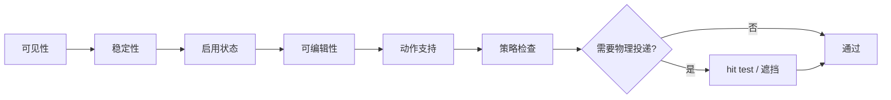

# 第 2 章 可操作性：预检、派发与门控

## 本章要回答什么

第 1 章结束时，我们手里有一个 ref 和它的身份证据。**但这不代表动作能成功。**

本章回答三个问题：

1. 动作发出去之前，系统怎么判断"这个元素现在能操作"？
2. 判断通过后，动作按什么策略投递？
3. 失败时，哪些情况值得恢复，哪些必须直接拒绝？

一句话：第 1 章讲"怎么找到元素"，本章讲"怎么确认它真的能动"。

## 看见 ≠ 能操作

一个元素出现在无障碍树里，只说明它存在。它可能：

- 被禁用（disabled）；
- 被隐藏或滚出视口（hidden / offscreen）；
- 被其他窗口或弹窗遮挡；
- 正在动画中，位置还不稳定；
- 不支持你要执行的动作；
- 需要先获得焦点，才接受键盘输入。

这些条件任何一条不满足，动作都不该发出去。发出去再失败，会把"元素不可操作"和"动作执行失败"混在一起，调用方无法判断该重试还是该换目标。

## 预检的顺序

门控不是随便检查，而是有顺序的：先便宜、后昂贵；先静态、后动态。

前面的检查失败，就不必再做后面的昂贵检查。这也是为什么第 1 章说"预检是动作前的边界"。

## 投递策略

预检通过后，动作还要决定怎么投递：

- **语义投递**：直接调用平台的可访问性动作，不移动真实光标；
- **物理投递**：需要真实鼠标或键盘事件，必须先确认指针确实能到达目标。

`InteractionPolicy` 由调用方要求和动作自身要求 join 而成，取更严格的那个。语义动作默认 headless；显式按键才允许 focus 而不移动光标。

## 三节的分工

| 小节 | 回答的问题 | 主要代码 |
| --- | --- | --- |
| 2.1 预检 | 动作前怎么确认能操作 | `ref_action/mod.rs` 的 `preflight_resolved` |
| 2.2 派发 | 预检通过后怎么组装请求、怎么投递 | `commands/execute_by_ref.rs` |
| 2.3 门控 | 预检内部由哪些检查组成 | `actionability/evaluate.rs`、`check.rs` |

三节按"结论 → 调用 → 内部"排：先看预检如何被调用，再看派发，最后拆开预检内部的每一道门。

## 阅读约定

- 仍然只读，不修改源码。
- 跨文件是常态：预检在 `ref_action`，门控在 `actionability`，请求在 `actions`。
- 看到某个门失败时，先问"它在防止哪种误判"。

## 读完之后

你应该能：

- 说清预检的顺序，以及为什么先检查可见性和稳定性；
- 解释语义投递与物理投递的差别；
- 指出一个元素"存在但不能操作"的五种常见原因；
- 说明预检失败时，什么情况会触发滚动恢复。
