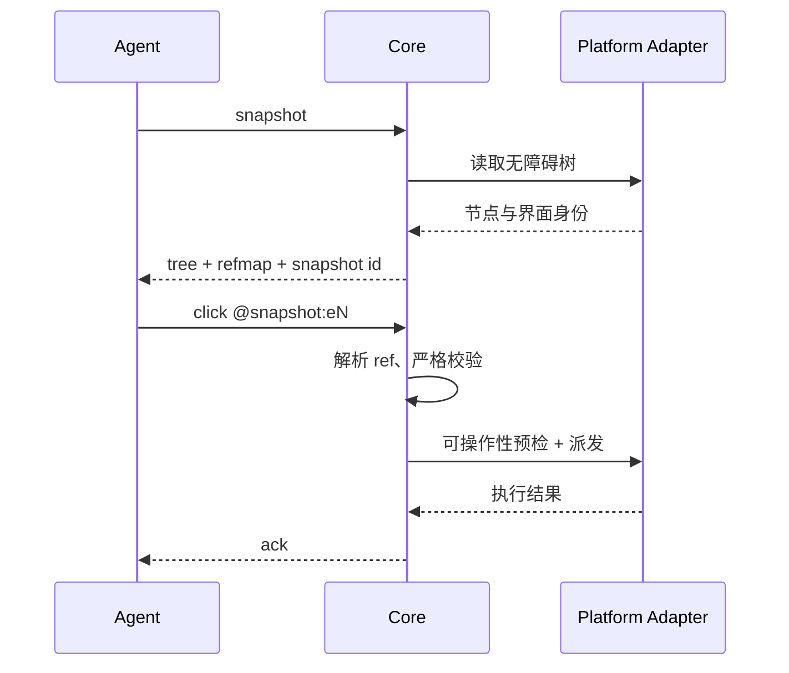
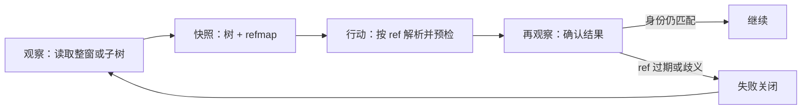
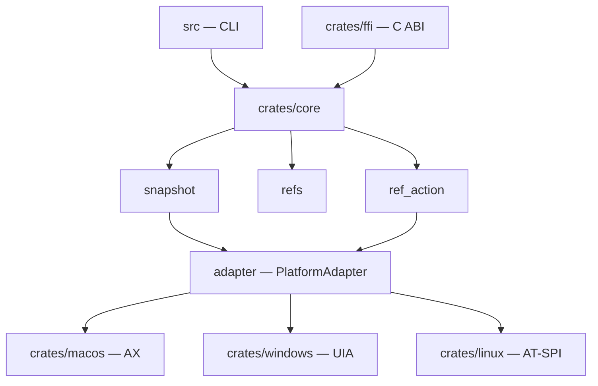

# agent-desktop 源码分析 · 导读

## 这门课怎么讲

这门课只分析**一个版本**：2026-11-05 的 `b43ac4f6`。课程不会在播放中切换提交，也不做回滚。原因很简单：源码分析需要稳定的行号和稳定的调用链，历史回放会把"读懂当前实现"和"理解演进"混在一起。

历史不是不讲，而是**按需查**。需要背景时，直接看这三个提交：

| 想看的转折 | 提交 | 看什么 |
| --- | --- | --- |
| 第一天立起的骨架 | `a346f242` | 31 个命令、`snapshot.rs` 与 `refs.rs` 还是单文件 |
| 同一天的 47 条评审修正 | `218503a7` | 30 个文件、+459/−230，错误定义与调用点被重新对齐 |
| `refs.rs` / `snapshot.rs` 消失 | `4c598cde`（#311） | 单文件被目录取代，Linux 支持与隐私加固同时进入 |

课程里的讲解以当前代码为准；提到历史时，只作为"为什么现在是这样"的注脚，不要求学习者 checkout 旧版本。

## 项目要解决什么

agent-desktop 想给 AI Agent 一双"看桌面"和"操作桌面"的手。它不截图，也不做像素匹配，而是读取操作系统的**无障碍树**（accessibility tree），把界面结构化成 JSON，并给每个可操作元素分配一个 `ref`。

核心循环很短：

一次交互是三步：**观察**拿到带 `ref` 的快照 → **行动**按 `ref` 操作 → **再观察**确认结果。循环本身不在库里，库只提供观察和操作两个能力；决定"下一步做什么"的是调用方的 Agent。

它同时以 CLI 和 C 库发布：CLI 给人调试和给 Agent 调工具，C 库让宿主程序在进程内调用同一套核心。两种形态共享 `agent-desktop-core`，所以本课程的代码阅读对两者都成立。

## 为什么是无障碍树

截图方案的问题不是"识别得不够准"，而是**不可验证**：

- 同一张图，两次识别可能给出不同结论；
- 动作失败时，只能靠"看起来没反应"判断；
- 窗口移动、缩放、主题变化都会让坐标失效；
- 隐私内容（密码框、通知、剪贴板）容易进入截图。

无障碍树是结构化的：角色、名称、层级、可操作状态都是明确字段。观察因此变成可断言的数据，操作变成对具体元素的引用，而不是对某个像素位置的猜测。

代价同样真实：树会过期，元素会被重建，应用会重启，`ref` 会失效。后面几章的大部分设计，都是在处理这个代价：

## 引用的生命周期

`ref` 不是一个稳定的全局 ID，而是"某一次快照里的短标识"：

| 概念 | 含义 |
| --- | --- |
| Snapshot | 某一时刻对树的观察，连同这次分配的 `ref` 一起持久化 |
| Snapshot ID | 快照的短标识，只在选定会话命名空间内有效 |
| Ref | 分配给可操作或可下钻节点的短标识，形如 `@eN` |
| RefMap | `ref` 到"重新识别元素所需证据"的映射，不存坐标 |
| Stale Ref | 存下来的身份已不足以安全操作 |
| Strict Resolution | 逐项比对证据，找不到、过期、歧义都失败关闭 |

几个容易误读的点：

- **可操作有严格定义**：角色可交互，或声明了主操作。`focus`、右键菜单、滚动到可见本身不算——Web 运行时几乎给每个节点都挂这些能力。
- **跨快照必须限定**：输出用 `@<snapshot_id>:eN`，命令只接受限定形式，裸 `@eN` 直接 `INVALID_ARGS`。
- **证据不是坐标**：窗口句柄、进程实例、角色、稳定名称与描述才是证据；值、边界、标题漂移都不作为身份。
- **失败关闭**：解析不到唯一匹配就拒绝，不猜。这是"旧观察"与"实时桌面"之间的边界。

下钻（Drill-down）是一个特殊分支：它从已有 `ref` 出发，只观察那个元素的子树，并替换快照里对应的引用。正因为是"替换"，它必须完整观察；部分结果只允许出现在全量快照里。

## 代码怎么分层

`agent-desktop-core` 只通过 `PlatformAdapter` 接触操作系统，不直接调用任何平台 API。每个平台二进制只为一个 OS 构建，对应那个 OS 的无障碍接口：

| 平台 | 最低要求 | 无障碍 API |
| --- | --- | --- |
| macOS | macOS 13+，Intel 或 Apple Silicon | AX API |
| Windows | Windows 10 1809+，x64 或 ARM64 | UI Automation |
| Linux | Ubuntu 24.04+，x86_64 或 aarch64，X11/Wayland | AT-SPI |

工作区有六个 crate：`core`、三个平台后端、`ffi`、`src`（CLI）。版本 1.2.0，Apache-2.0，edition 2024，最低 Rust 1.89。

## 当前架构的五个切面

| 切面 | 要回答的问题 | 主要代码 |
| --- | --- | --- |
| 分层 | 命令、核心链路、平台适配如何分开 | `lib.rs`、`commands/`、`adapter/` |
| 观察 | 树如何变成带 ref 的快照，完整性与部分结果如何表达 | `snapshot/mod.rs`、`snapshot/snapshot_ref.rs` |
| 引用 | ref 如何分配、限定、失效、被替换 | `refs/mod.rs`、`refs/ref_token.rs`、`refs/ref_alloc*` |
| 动作 | ref 如何解析、预检、滚动恢复、派发 | `ref_action/mod.rs`、`commands/execute_by_ref.rs` |
| 平台适配 | 三个后端如何各自实现同一组能力 | `crates/{macos,windows,linux}` |

第 1 章覆盖前四个；平台适配需要同时读三个 crate，留到后续章节。

## 课程地图

| 单元 | 内容 |
| --- | --- |
| 导览 `what_it_is` | 项目定位、观察循环、核心概念、引用生命周期 |
| 导览 `how_it_works` | CLI/C 库调用链、命令分组、平台差异、代码位置 |
| 1.1 模块地图 | `lib.rs` 的模块划分与并列关系 |
| 1.2 观察 | `snapshot` 命令、`SnapshotResult`、下钻边界 |
| 1.3 引用 | `RefMap` 的分配、限定与失效 |
| 1.4 行动 | 可操作性预检、滚动恢复、`execute_by_ref` 五步管线 |

第 1 章按"命令 → 结果 → 下钻 → 引用 → 预检 → 派发"推进。每一步都用 `RevealText` 把当前讨论的行滚进视口；讲完清除高亮，不留下视觉残留。

## 怎么读这份代码

建议顺序不是从 `main.rs` 开始，而是沿着一次真实调用走：

1. **先看形状**：`SnapshotResult` 有哪些字段，哪些表示"观察到了什么"，哪些表示"这次观察可不可信"；
2. **再看分配**：`RefMap` 如何给节点编号，编号为什么会失效；
3. **再看执行**：`execute_by_ref` 的注释已经把五步管线写全，顺着它读 `preflight_resolved` 与 `dispatch_resolved_landing`；
4. **最后看平台**：只有在需要理解"为什么某个能力在某个平台不可用"时，再进入对应的 crate。

阅读时可以刻意忽略的东西：测试文件、`skills/`、`npm/` 打包脚本、`benchmarks/`、`probes/`。它们不影响核心链路的理解。

## 工作目录与只读约定

课程包里的 `shared/agent-desktop/` 会在首次开始 Unit 时复制到 `workspace/resources/agent-desktop/`，所有章节共用这一份。副本带 `.git`，可以直接在工作目录里查历史、做 `git log`。

课程按**只读**方式使用源码：

- 不包含任何编辑类动作；
- 不要求学习者修改文件；
- 想自己试验时，建议另开一份副本，避免下一次 Unit 的 `RevealText` 行号漂移。

`shared/` 不进开发者仓库（`.gitignore` 忽略），分发时由打包流程带入。

## 术语速查

| 术语 | 一句话 |
| --- | --- |
| Accessibility Tree | 操作系统暴露的界面结构，观察与语义操作的唯一事实来源 |
| Snapshot | 某一刻的树 + 这次分配的 refmap |
| Surface | 可单独观察的界面层（菜单、弹窗、焦点区域） |
| Drill-down | 从已有 ref 出发，只观察并替换那个子树 |
| Partial Observation | 超时后返回的部分结果，只允许全量快照 |
| Actionability | 元素当前是否可安全操作；预检失败可触发滚动恢复 |
| Interaction Policy | 调用方与动作自身策略的 join，决定是否允许 focus/headed |
| Strict Resolution | 失败关闭的 ref 重新识别 |

## 来源与许可

- 上游仓库：`https://github.com/lahfir/agent-desktop`
- 许可：Apache-2.0，副本见 `shared/agent-desktop/LICENSE`
- 课程只引用公共提交信息与文档；章节划分和讲解判断属于课程作者，不代表上游立场
